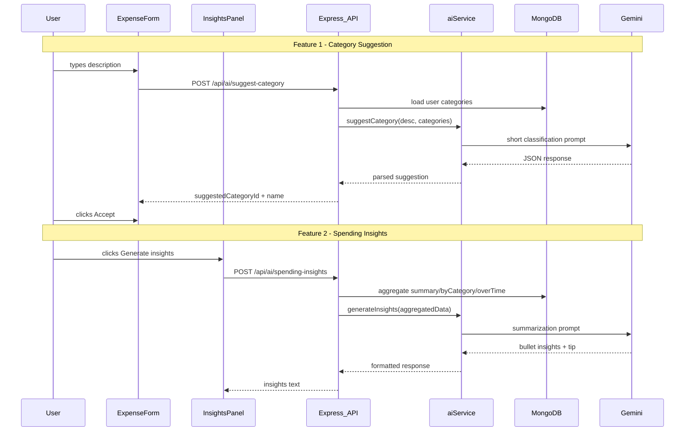

# Budget Tracker — Build Steps

Incremental build plan covering version control, database design, backend, auth, frontend, documentation, and **Week 3 AI features**. **Complete each step fully, run the Verify checkpoint, then commit** with a conventional message (`feat:`, `fix:`, `chore:`, `docs:`) before moving on.

Close the matching GitHub issue when the step is verified.

> **Week 2 note:** Formal automated testing is not required — manual Verify checkpoints are sufficient. Endpoint/unit tests are covered in Week 3.
>
> **Week 3 (Steps 18–27):** Two AI features powered by Google Gemini (`gemini-2.0-flash`, server-side only): smart category suggestion and AI spending insights. See [AI architecture](#ai-architecture) and [AI feature reference](#ai-feature-reference) at the end of this doc.

---

## Step 0 — GitHub Classroom & repository bootstrap

**Requirement:** §1 Version Control & CI/CD Setup

**Goal:** Accept the assignment, initialize the project skeleton, and establish secrets hygiene.

**Tasks:**

- Accept assignment via GitHub Classroom: https://classroom.github.com/a/nUSqhsBz
- Clone the Classroom repository; configure Git and SSH keys if needed
- Initialize repo structure: `client/` (Vite + React), `server/` (Express)
- Add root `.gitignore` (`.env`, `node_modules/`, `dist/`, `.netlify/`, etc.)
- Add `server/.env.example` and `client/.env.example` with placeholder variables
- Add `PLAN.md`, `BUILD_STEPS.md`, and stub `README.md`
- Create GitHub project board and issues for Steps 0–28

**Verify:**

- [ ] Assignment accepted; repo cloned and remote configured
- [ ] `git status` shows no secrets tracked
- [ ] Both apps have `package.json` and install without errors
- [ ] Project board exists with issues linked to this doc

**Commit:** `chore: bootstrap monorepo and planning docs`

---

## Step 1 — Database design documentation

**Requirement:** §2 Database Design

**Goal:** Document the data model, ERD, and design decisions before implementation.

**Tasks:**

- Finalize collections: `users`, `categories`, `transactions` (see `PLAN.md`)
- Create `docs/DATA_MODEL.md` with schema tables and Mermaid ERD
- Document key design decisions (MongoDB choice, per-user isolation, category model, etc.)
- Note read/write scope: all queries filtered by `userId` (custom backend equivalent of BaaS permissions)

**Verify:**

- [ ] ERD shows relationships between User, Category, and Transaction
- [ ] Each collection has field types, constraints, and indexes documented
- [ ] Design decisions table explains *why*, not just *what*

**Commit:** `docs: add data model, ERD, and design decisions`

---

## Step 2 — Express server foundation

**Requirement:** §3 Backend & Data Access

**Goal:** Minimal API server runs locally.

**Tasks:**

- Install Express, cors, dotenv, morgan
- Create `server/index.js` (or `server/src/index.js`) with health route `GET /api/health`
- Add `npm run dev` with nodemon
- Read `PORT` and `MONGODB_URI` from `.env`

**Verify:**

- [ ] `npm run dev` starts server on configured port
- [ ] `curl http://localhost:5000/api/health` returns `{ "status": "ok" }`

**Commit:** `chore: add Express server with health endpoint`

---

## Step 3 — MongoDB connection

**Requirement:** §3 Backend & Data Access

**Tasks:**

- Install Mongoose
- Create `server/config/db.js` connection helper
- Connect on server startup; log success/failure
- Create free MongoDB Atlas cluster and database user
- Store `MONGODB_URI` in local `.env` only

**Verify:**

- [ ] Server logs successful MongoDB connection
- [ ] Disconnect URI → server reports connection error gracefully

**Commit:** `feat: connect Express to MongoDB Atlas`

---

## Step 4 — User model and registration

**Requirement:** §4 Authentication System

**Tasks:**

- Install bcryptjs, jsonwebtoken, express-validator
- Create `User` model (`email`, `password`, `name`)
- `POST /api/auth/register` — validate input, hash password, save user
- Return 409 if email exists; never return password hash in JSON

**Verify:**

- [ ] Register via Postman/curl creates document in Atlas `users` collection
- [ ] Password in DB is bcrypt hash, not plaintext
- [ ] Duplicate email returns appropriate error

**Commit:** `feat: add user registration with bcrypt`

---

## Step 5 — Login and JWT auth middleware

**Requirement:** §4 Authentication System

**Tasks:**

- `POST /api/auth/login` — verify credentials, issue JWT
- `GET /api/auth/me` — return current user (protected)
- Create `authenticate` middleware (read `Authorization: Bearer <token>` or httpOnly cookie)
- `POST /api/auth/logout` (optional: client-side token clear is enough for MVP)

**Verify:**

- [ ] Login returns token; `/api/auth/me` works with token
- [ ] `/api/auth/me` without token returns 401
- [ ] Invalid token returns 401

**Commit:** `feat: add JWT login and auth middleware`

---

## Step 6 — Category CRUD API

**Requirement:** §3 Backend & Data Access

**Tasks:**

- Create `Category` model (`userId`, `name`, `color`)
- Routes: `GET/POST /api/categories`, `PUT/DELETE /api/categories/:id`
- Scope all queries by `req.user.id`
- Seed default categories on first login or register (optional)

**Verify:**

- [ ] Create category with valid token → 201
- [ ] List returns only current user's categories
- [ ] Update/delete another user's category ID → 403 or 404
- [ ] Requests without token on POST/PUT/DELETE → 401

**Commit:** `feat: add category CRUD API`

---

## Step 7 — Transaction CRUD API

**Requirement:** §3 Backend & Data Access

**Tasks:**

- Create `Transaction` model (`userId`, `categoryId`, `amount`, `description`, `date`)
- Routes: full CRUD on `/api/transactions`
- Validate `categoryId` belongs to same user
- Support query params: `?startDate=&endDate=&categoryId=`

**Verify:**

- [ ] Create transaction linked to valid category
- [ ] List/filter returns correct user's data only
- [ ] Update amount and date persists in MongoDB
- [ ] Delete removes document
- [ ] Unauthenticated POST/PUT/DELETE → 401

**Commit:** `feat: add transaction CRUD API`

---

## Step 8 — Analytics API

**Requirement:** §3 Backend & Data Access (optional server-side logic)

**Tasks:**

- `GET /api/analytics/summary` — total spend, count, top category (date range optional)
- `GET /api/analytics/by-category` — array `{ category, total, color }`
- `GET /api/analytics/over-time` — array `{ period, total }` (daily default)
- Use MongoDB aggregation pipelines; scope by `userId`

**Verify:**

- [ ] After seeding test transactions, summary totals are correct
- [ ] by-category sums match manual calculation
- [ ] over-time buckets align with transaction dates
- [ ] No auth → 401

**Commit:** `feat: add analytics aggregation endpoints`

---

## Step 9 — React app shell (Vite + Tailwind)

**Requirement:** §5 Frontend Integration

**Tasks:**

- `npm create vite@latest client -- --template react`
- Install and configure Tailwind CSS
- Install React Router, axios (or fetch wrapper)
- Create `services/api.js` with base URL from `VITE_API_URL`
- Pages: placeholder `Login`, `Register`, `Dashboard`
- Add proxy or CORS note for local dev

**Verify:**

- [ ] `npm run dev` opens React app
- [ ] Tailwind utility classes render (e.g. styled heading)
- [ ] Navigation between placeholder pages works

**Commit:** `feat: scaffold React client with Tailwind and routing`

---

## Step 10 — Auth UI and protected routes

**Requirement:** §4 Authentication System · §5 Frontend Integration

**Tasks:**

- Build `Register` and `Login` forms with client-side validation
- `AuthContext` stores user + token (memory/localStorage per your security choice)
- Attach token to API requests via interceptor
- `ProtectedRoute` redirects anonymous users to `/login`
- Show login prompt when anonymous user attempts a write action

**Verify:**

- [ ] Register → auto-login or redirect to login → dashboard
- [ ] Invalid credentials show error message
- [ ] Visiting `/dashboard` logged out redirects to `/login`
- [ ] Logout clears session and blocks dashboard

**Commit:** `feat: add auth UI and protected routes`

---

## Step 11 — Dashboard: expenses and categories UI

**Requirement:** §5 Frontend Integration

**Tasks:**

- Summary stat cards (fetch `/api/analytics/summary`)
- `ExpenseForm` — amount, category dropdown, date, description → `POST /api/transactions`
- `TransactionList` — list with edit modal and delete confirm
- Category manager (inline or modal) wired to category API
- Loading and error states

**Verify:**

- [ ] Add expense → appears in list and in MongoDB
- [ ] Edit transaction updates UI and DB
- [ ] Delete removes from list
- [ ] Category dropdown shows user's categories
- [ ] Logged-out user cannot submit form (redirect or disabled + prompt)

**Commit:** `feat: add dashboard expense form and transaction list`

---

## Step 12 — Charts

**Requirement:** §5 Frontend Integration

**Tasks:**

- Install Chart.js + react-chartjs-2 (or Recharts)
- `SpendingByCategoryChart` — pie/donut from `/api/analytics/by-category`
- `SpendingOverTimeChart` — line/bar from `/api/analytics/over-time`
- Date range filter (e.g. this week / this month) refreshes charts and list
- Use category colors from API

**Verify:**

- [ ] Charts render with real data after adding expenses
- [ ] Adding/editing/deleting transaction updates charts
- [ ] Empty state shown when no transactions
- [ ] Charts responsive on mobile width

**Commit:** `feat: add spending visualization charts`

---

## Step 13 — Error handling, polish, and API hardening

**Requirement:** §3 Backend & Data Access (error handling and validation)

**Tasks:**

- Central Express error handler middleware
- Input validation on all routes (express-validator)
- 404 handler for unknown API routes
- Frontend toast or inline errors for API failures
- Consistent date/currency formatting (`$12.34`, locale dates)

**Verify:**

- [ ] Invalid payload returns 400 with clear message
- [ ] Network failure shows user-friendly error on frontend
- [ ] No unhandled promise rejections in server logs during normal use

**Commit:** `fix: improve validation and error handling`

---

## Step 14 — CI/CD pipeline with automatic deployment

**Requirement:** §1 Version Control & CI/CD Setup

**Tasks:**

- Add `.github/workflows/ci.yml`
- Jobs: install `server` + `client` deps, lint (if configured), build client
- Configure hosting: MongoDB Atlas, backend (Render/Railway), frontend (Netlify/Vercel)
- Configure **automatic deployment on push to `main`**
- Store deploy tokens and secrets in GitHub repository secrets (not in code)
- Push code to GitHub Classroom repository

**Verify:**

- [ ] Push to branch triggers workflow
- [ ] Workflow passes on `main`
- [ ] Push to `main` triggers automatic deployment
- [ ] Deployed URLs are reachable after push

**Commit:** `chore: add CI/CD pipeline with deploy on push to main`

---

## Step 15 — Documentation

**Requirement:** §6 Documentation

**Tasks:**

- Expand `README.md`: project overview (problem + solution), screenshots, prerequisites, clone/install/run, env table, live URL
- Ensure `docs/DATA_MODEL.md` is current (schema, ERD, design decisions)
- `docs/ARCHITECTURE.md` — how frontend, Express backend, and MongoDB fit together
- `docs/USAGE.md` — register, log in, add/edit/delete expenses, read charts
- `docs/DEPLOYMENT.md` — Atlas, backend host, frontend host, CI/CD deploy flow
- Ensure `.env.example` files are complete and accurate

**Verify:**

- [ ] New developer can follow README and run app locally
- [ ] All six documentation areas are covered
- [ ] ERD matches implemented Mongoose models
- [ ] Live deployed URL appears in README

**Commit:** `docs: add architecture, usage, and deployment guides`

---

## Step 16 — Deploy verification and smoke test

**Requirement:** §1 Version Control & CI/CD · Required practices (verify before deploy)

**Goal:** Test locally, then smoke-test the live URL before final submission.

**Tasks:**

- Confirm MongoDB Atlas, backend host, and frontend host are configured (from Step 14)
- Configure CORS on backend for production frontend origin
- Add deployed URL to README

**Verify (local first, then live):**

- [ ] Local happy path: register → login → CRUD → charts
- [ ] Local auth check: anonymous write blocked; user prompted to log in
- [ ] Production smoke test: same flow on deployed URL
- [ ] No secrets in repository

**Commit:** `chore: verify production deployment`

---

## Week 3 — AI Features (Steps 18–27)

**Scope:** Implement two AI features for the Budget Tracker:

1. **Smart Category Suggestion** — auto-suggest a category while typing an expense description
2. **AI Spending Insights** — plain-English spending summary for the selected date range

**Provider:** Google Gemini `gemini-2.0-flash` (free tier, server-side only)

**Integration points:** `client/src/components/ExpenseForm.jsx`, `client/src/pages/Dashboard.jsx`, `server/controllers/analyticsController.js`, `server/index.js` (mount `/api/ai`)

**Auth rule:** All `/api/ai/*` routes require JWT. Client hooks are disabled for anonymous users; write actions show `LoginPrompt`.

---

## Step 18 — AI planning and issue setup

**Requirement:** Week 3 planning docs · issue tracking

**Goal:** Document AI scope in `PLAN.md` and track work on the project board.

**Tasks:**

- Add AI features to **In scope** in `PLAN.md`:
  - Smart category suggestion (debounced, AI + keyword fallback)
  - AI spending insights card (button-triggered, 1h cache)
  - Server-side Gemini via `aiService.js` (no client API keys)
  - Per-user rate limit (30 req/hour shared across AI endpoints)
- Add API rows to `PLAN.md`: `POST /api/ai/suggest-category`, `POST /api/ai/spending-insights` (auth required)
- Create GitHub issues for Steps 18–28 on the project board (extend `scripts/create-github-issues.sh` or use `gh issue create`)
- Move enhancements (OAuth, receipt OCR, streaming insights) to **Backlog** column

**Verify:**

- [ ] `PLAN.md` lists both AI features and new `/api/ai` endpoints
- [ ] Project board has open issues for each AI step (18–28)

**Commit:** `docs: add AI feature scope and build steps`

---

## Step 19 — Secrets hygiene for Gemini

**Requirement:** Secrets hygiene

**Goal:** Configure API keys safely before any AI code runs.

**Tasks:**

- Add to `server/.env.example`:

  ```
  GEMINI_API_KEY=<your-gemini-api-key>
  AI_MODEL=gemini-2.0-flash
  AI_RATE_LIMIT_WINDOW_MS=3600000
  AI_RATE_LIMIT_MAX=30
  ```

- Copy values into local `server/.env` (key from [Google AI Studio](https://aistudio.google.com/apikey))
- Confirm root `.gitignore` ignores `.env`, `.env.local`, `.netlify/`, `.vercel/`
- **Never** add `GEMINI_API_KEY` to the React client or any `VITE_*` variable

**Verify:**

- [ ] `git status` does not show `server/.env`
- [ ] `server/.env.example` has placeholders (no real keys)
- [ ] `grep -r GEMINI_API_KEY client/` returns nothing

**Commit:** `chore: add Gemini env vars to server .env.example`

---

## Step 20 — Shared AI infrastructure

**Requirement:** Week 3 AI API integration

**Goal:** Gemini client wrapper, prompts, errors, rate limiter, and authenticated route shell.

**Tasks:**

- Install: `cd server && npm install @google/generative-ai`
- Create server files:

  | File | Purpose |
  |------|---------|
  | `server/services/aiService.js` | Gemini client, `callGemini()`, error handling |
  | `server/utils/aiPrompts.js` | Prompt templates |
  | `server/utils/aiErrors.js` | `AiConfigError`, `AiServiceError`, `AiRateLimitError` |
  | `server/middleware/aiRateLimiter.js` | Per-user 30 req/hr in-memory limit |
  | `server/controllers/aiController.js` | Handlers (stubs OK until Steps 21/24) |
  | `server/routes/ai.js` | Route definitions + validation |

- Mount in `server/index.js`: `app.use('/api/ai', aiRoutes)`
- Apply `authenticate` and `aiRateLimiter` before handlers (follow `server/routes/analytics.js`):

  ```javascript
  router.use(authenticate);
  router.use(aiRateLimiter);
  router.post('/suggest-category', validation, handleValidation, asyncHandler(suggestCategory));
  router.post('/spending-insights', validation, handleValidation, asyncHandler(spendingInsights));
  ```

- `aiService.js`: check `GEMINI_API_KEY`, call Gemini with JSON response mode, retry once on 429, throw safe errors on failure (see [AI architecture](#ai-architecture))

**Verify:**

- [ ] Server starts with `GEMINI_API_KEY` set in `server/.env`
- [ ] `POST /api/ai/suggest-category` without token → 401
- [ ] `POST /api/ai/spending-insights` without token → 401
- [ ] Missing `GEMINI_API_KEY` → 503 with safe message (not stack trace)

**Commit:** `feat: add shared AI infrastructure and authenticated routes`

---

## Step 21 — Category suggestion API

**Requirement:** Week 3 AI feature 1

**Goal:** Backend endpoint that suggests a category from an expense description.

**Tasks:**

- Create `server/utils/categoryKeywords.js` — keyword fallback map (see [Feature 1 reference](#feature-1--smart-category-suggestion))
- Implement `aiController.suggestCategory`: load user categories → try AI → fallback to keywords on failure
- Add classification prompt in `aiPrompts.js`
- Validate AI response: `categoryId` must exist in user's list or treat as `null`
- Request validation: `description` required, string, trim, min 3, max 500 chars

**API:** `POST /api/ai/suggest-category` — success `200` with `{ suggestion: { categoryId, categoryName, confidence, source } }` or `{ suggestion: null }`. Errors: 400, 401, 429, 502, 503.

**Verify:**

- [ ] Postman/curl with valid token + `"Whole Foods groceries"` → suggestion with valid `categoryId`
- [ ] Description < 3 chars → 400
- [ ] No auth token → 401
- [ ] Invalid category ID from AI → treated as `null` (no crash)
- [ ] Unset `GEMINI_API_KEY` → keyword fallback or 503 as designed

**Commit:** `feat: add AI category suggestion endpoint`

---

## Step 22 — Category suggestion UI

**Requirement:** Week 3 AI feature 1 · auth protection

**Goal:** Debounced suggestion chip in the expense form; auth-gated on the client.

**Tasks:**

- Create `client/src/hooks/useCategorySuggestion.js`:
  - 500ms debounce, `AbortController` for stale requests
  - Skip if `description.length < 3` or `categories.length === 0`
  - Pass `{ enabled: isAuthenticated }` to disable when logged out
- Update `client/src/components/ExpenseForm.jsx`:
  - Loading: "Finding category…"
  - Chip: **Suggested: Groceries** with Accept / Dismiss
  - Call `clearSuggestion()` in `resetForm()`
- Anonymous users: hook disabled; login prompt blocks form submit

**Verify (local):**

- [ ] Logged in: type description → chip appears after debounce
- [ ] Accept → category dropdown updates
- [ ] Submit expense → suggestion clears
- [ ] Logged out: no API calls; form shows login prompt on submit
- [ ] AI failure: silent fallback or no chip (form still submittable)

**Commit:** `feat: add category suggestion UI to expense form`

---

## Step 23 — Extract analytics queries helper

**Requirement:** Week 3 AI feature 2 (prerequisite)

**Goal:** Shared aggregation logic for analytics API and spending insights.

**Tasks:**

- Refactor `server/controllers/analyticsController.js` → extract `server/utils/analyticsQueries.js` with `fetchAnalyticsBundle(userId, query)`
- Update `analyticsController` to call the helper (no behavior change)

**Verify:**

- [ ] Existing analytics endpoints return same data as before refactor
- [ ] `GET /api/analytics/summary` without token → 401

**Commit:** `refactor: extract shared analytics query helper`

---

## Step 24 — Spending insights API

**Requirement:** Week 3 AI feature 2

**Goal:** Backend endpoint that generates plain-English spending insights.

**Tasks:**

- Create `server/utils/insightsCache.js` — in-memory Map, 1h TTL
- Implement `aiController.spendingInsights` using `fetchAnalyticsBundle`
- Add `buildCompactAnalyticsPayload()` — ~200 tokens, not raw transactions (see [Feature 2 reference](#feature-2--ai-spending-insights))
- Add summarization prompt in `aiPrompts.js`
- Support `forceRefresh: true` to bypass cache
- Skip Gemini call when `transactionCount === 0`

**API:** `POST /api/ai/spending-insights` — body: `{ startDate, endDate, dateRangeLabel, forceRefresh }`. Success: `{ insights: { bullets, tip, generatedAt, cached } }` or `{ insights: null, message }`.

**Verify:**

- [ ] Period with transactions → bullets + tip
- [ ] Empty period → `insights: null`, no Gemini call
- [ ] Second request same range → `cached: true`
- [ ] `forceRefresh: true` → `cached: false`
- [ ] No auth token → 401

**Commit:** `feat: add AI spending insights endpoint`

---

## Step 25 — Spending insights UI

**Requirement:** Week 3 AI feature 2 · auth protection

**Goal:** Dashboard card with generate/regenerate flow; auth-gated.

**Tasks:**

- Create `client/src/components/InsightsPanel.jsx`
- Wire into `client/src/pages/Dashboard.jsx` after `SummaryCards`
- Add `DATE_RANGE_LABELS` to `client/src/utils/dateRange.js`
- Clear displayed insights when date range changes
- Button states: "Generate insights" / "Analyzing…" / "Regenerate"
- Only render actionable button for authenticated users

**Verify (local):**

- [ ] Generate insights → spinner → bullets + tip display
- [ ] Change date range → insights clear
- [ ] Regenerate → fresh insights (`cached: false`)
- [ ] Empty period → friendly message, no error
- [ ] Logged out: panel disabled or prompts login (no API call)

**Commit:** `feat: add AI spending insights panel to dashboard`

---

## Step 26 — AI documentation

**Requirement:** Week 3 documentation · cost analysis

**Goal:** Document features, costs, and API usage.

**Tasks:**

- Add **AI Features** section to `README.md` (what each feature does, `GEMINI_API_KEY` setup, rate limits, cache)
- Create `docs/COST_ANALYSIS.md` with token/cost table (both features ≈ $0 on Gemini free tier)
- Document Postman requests for both `/api/ai/*` endpoints with auth header

**Verify:**

- [ ] README explains local Gemini setup
- [ ] Cost analysis table present
- [ ] New developer can find AI env vars in `server/.env.example`

**Commit:** `docs: add AI feature documentation and cost analysis`

---

## Step 27 — Local verify and production deploy

**Requirement:** Verify before deploy

**Goal:** Test locally (happy path + auth), deploy, then smoke-test live URL.

**Tasks:**

- **Local verify first** (do not deploy until these pass):
  - Happy path: register → login → add expense → category suggestion → generate insights
  - Auth API: `POST /api/ai/*` without token → 401
  - Auth UI: logged out → no AI API calls; login prompt on writes
  - Secrets: `git status` shows no `.env`; no API keys in git history
- Add `GEMINI_API_KEY` to Render dashboard env vars
- Push to `main` → CI passes → auto-deploy
- **Production smoke test:** log in → suggestion chip → generate insights → no console errors

**Verify:**

- [ ] Local happy path passes (both AI features)
- [ ] Local auth checks pass (API 401 + UI login prompt)
- [ ] `GEMINI_API_KEY` set on Render (not in repo)
- [ ] Production smoke test passes on deployed URL
- [ ] Close GitHub issues for Steps 18–27 (Step 28 closes all remaining)

**Commit:** `chore: verify AI features in production`

---

## Step 28 — Demo video and final review

**Requirement:** Deliverables · Evaluation Criteria

**Goal:** Record demo and close out all project issues after MVP + AI features are complete.

**Tasks:**

- Record 2–3 minute demo: **registration, login, and CRUD operations** (required in deliverables)
- Include chart visualization, auth protection demo, and both AI features
- Close all completed GitHub issues (Steps 0–28)
- Move backlog items (OAuth, receipt OCR, budgets, etc.) to Backlog column
- Final README check for deployed URL and documentation links

**Verify:**

- [ ] Demo shows registration, login, full CRUD, and AI features
- [ ] All issues closed on project board
- [ ] Project deliverables and evaluation criteria satisfied

**Commit:** `docs: add demo link and finalize README` (if needed)

---

## Quick reference — environment variables

### Server (`server/.env`)

```
PORT=5000
MONGODB_URI=mongodb+srv://<user>:<pass>@<cluster>/<db>?retryWrites=true&w=majority
JWT_SECRET=<long-random-string>
JWT_EXPIRES_IN=7d
CLIENT_URL=http://localhost:5173
NODE_ENV=development
GEMINI_API_KEY=<your-gemini-api-key>
AI_MODEL=gemini-2.0-flash
AI_RATE_LIMIT_WINDOW_MS=3600000
AI_RATE_LIMIT_MAX=30
```

### Client (`client/.env`)

```
VITE_API_URL=http://localhost:5000/api
```

---

## Backlog (post-MVP issues)

- Google OAuth login
- AI budget recommendations with monthly caps
- Receipt OCR for auto-fill expense fields
- Streaming insights (SSE)
- Monthly budget caps with warning badges
- Recurring expenses
- CSV export
- Dark mode toggle
- Cloud functions / scheduled jobs (optional server-side logic per §3)

---

## AI architecture



---

## AI feature reference

Technical details referenced by Steps 21–25.

### Feature 1 — Smart Category Suggestion

**UX:** Type description (min 3 chars) → 500ms debounce → chip with Accept/Dismiss → clears on submit. AI failure → keyword fallback → show nothing (never block submit).

**Classification prompt (`aiPrompts.js`):**

```
You are a budget app assistant. Given an expense description and a list of the user's categories, pick the single best matching category.

Categories (id → name):
{categoryList}

Expense description: "{description}"

Respond with JSON only:
{
  "categoryId": "<exact id from list or null>",
  "confidence": "high" | "medium" | "low",
  "reasoning": "<one short sentence>"
}

Rules:
- categoryId MUST be one of the provided ids, or null if no good match
- Do not invent categories
- Prefer the most specific match
```

**Keyword fallback (`categoryKeywords.js`):**

```javascript
const KEYWORD_MAP = [
  { keywords: ['uber', 'lyft', 'gas', 'parking', 'metro', 'transit'], names: ['transport', 'transportation', 'travel', 'auto'] },
  { keywords: ['grocery', 'whole foods', 'trader joe', 'walmart', 'costco'], names: ['groceries', 'food'] },
  { keywords: ['restaurant', 'lunch', 'dinner', 'coffee', 'starbucks', 'doordash'], names: ['dining', 'food', 'restaurants'] },
  { keywords: ['netflix', 'spotify', 'subscription'], names: ['entertainment', 'subscriptions'] },
  { keywords: ['rent', 'mortgage', 'utilities', 'electric'], names: ['housing', 'bills', 'utilities'] },
];
```

| Edge case | Behavior |
|-----------|----------|
| Description < 3 chars | No API call |
| 0 categories | No API call |
| AI returns null | Hide chip |
| Rate limited | Subtle pause message; keyword fallback may work |
| Network offline | No chip; form works normally |

---

### Feature 2 — AI Spending Insights

**UX:** Dashboard card → "Generate insights" → spinner → 3–5 bullets + tip → Regenerate bypasses cache → date range change clears insights → empty period shows message without calling AI.

**Summarization prompt (`aiPrompts.js`):**

```
You are a friendly personal finance assistant. Analyze this spending data and provide helpful insights.

Data:
{jsonPayload}

Respond with JSON only:
{
  "bullets": ["<insight 1>", "<insight 2>", "<insight 3>"],
  "tip": "<one specific, actionable savings tip>"
}

Rules:
- Provide 3 to 5 bullet insights
- Use dollar amounts from the data (format as $X.XX)
- Mention the top category and its percentage
- Note any spending spikes or patterns in daily totals
- Keep each bullet to one sentence
- Tip should be practical and specific to the data
- Do not invent transactions or categories not in the data
- Be encouraging, not judgmental
```

**Compact payload builder:**

```javascript
function buildCompactAnalyticsPayload(summary, byCategory, overTime, label) {
  const total = summary.totalSpend;
  return {
    period: label || 'Selected period',
    totalSpend: total,
    transactionCount: summary.transactionCount,
    topCategory: summary.topCategory,
    categories: byCategory.map(c => ({
      name: c.category,
      total: c.total,
      percent: total > 0 ? Math.round((c.total / total) * 100) : 0,
    })),
    dailyTotals: overTime.map(d => ({ date: d.period, total: d.total })),
    avgPerTransaction: total / summary.transactionCount,
    highestDay: overTime.reduce((max, d) => d.total > max.total ? d : max, overTime[0]),
  };
}
```

| Edge case | Behavior |
|-----------|----------|
| 0 transactions | Return `insights: null`, no Gemini call |
| Gemini error | 502 with friendly UI message |
| Cached result | Show footnote; Regenerate gets fresh response |

---

## AI testing checklist (Step 27)

**API (Postman/curl):**

- [ ] Category: valid description → valid `categoryId`; < 3 chars → 400; no auth → 401; invalid AI id → null; missing key → 503; 31st req/hr → 429
- [ ] Insights: period with data → bullets + tip; empty → `insights: null`; cache hit → `cached: true`; `forceRefresh` → fresh; no auth → 401

**UI smoke tests:**

- [ ] Category suggestion debounce, accept, clear on submit
- [ ] Insights generate, regenerate, clear on date change
- [ ] Anonymous user: no AI calls; login prompt on writes

