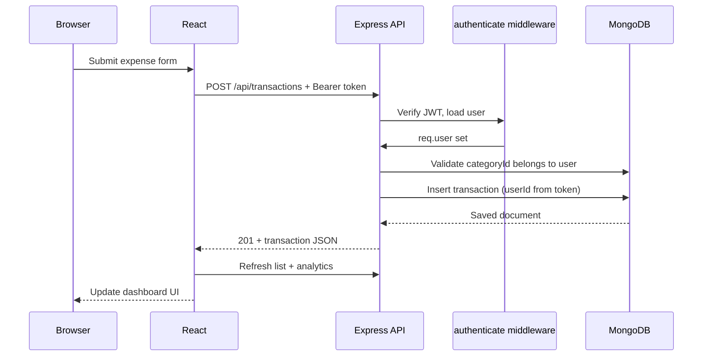
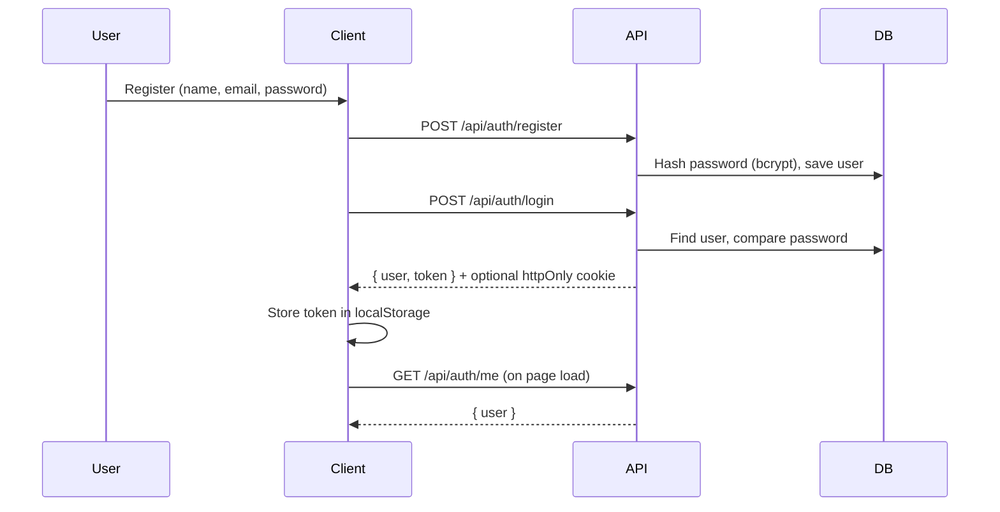

# Budget Tracker — Architecture

This document describes how the React frontend, Express API, and MongoDB database work together.

## System overview

```
┌─────────────────────┐     HTTPS/JSON      ┌─────────────────────┐     Mongoose     ┌─────────────────────┐
│  React + Tailwind   │ ◄─────────────────► │  Express REST API   │ ◄──────────────► │  MongoDB Atlas      │
│  (Vite, port 5173)  │   /api/*            │  (Node, port 5001)  │                  │                     │
│                     │                     │                     │                  │  users              │
│  Dashboard, charts  │   Bearer JWT        │  auth middleware    │                  │  categories         │
│  AuthContext        │   or httpOnly cookie│  validation         │                  │  transactions       │
└─────────────────────┘                     └─────────────────────┘                  └─────────────────────┘
```

| Component | Role |
|-----------|------|
| **Client** | SPA served by Vite in dev; static build on Netlify in production |
| **API** | REST endpoints for auth, CRUD, and analytics aggregations |
| **Database** | Document store with per-user isolation via `userId` |

## Repository layout

### Frontend (`client/`)

```
client/src/
├── components/       # UI: ExpenseForm, TransactionList, charts, CategoryManager
├── context/          # AuthProvider (session), ToastProvider (errors/success)
├── hooks/            # useAuth, useDashboardData, useRequireAuth, useToast
├── pages/            # Login, Register, Dashboard
├── services/         # api.js — Axios instance with token interceptor
└── utils/            # format.js, dateRange.js, errors.js, chartSetup.js
```

**Routing** (`App.jsx`):

- `/` → redirects to `/dashboard`
- `/login`, `/register` — guest-only (`GuestRoute`)
- `/dashboard` — protected (`ProtectedRoute`); unauthenticated users redirect to `/login`

**State:**

- `AuthContext` holds `user`, `login`, `register`, `logout`; restores session from `localStorage` token on load
- `useDashboardData` fetches categories, transactions, and analytics for the selected date range

### Backend (`server/`)

```
server/
├── config/db.js              # connectDB() — Mongoose connection on startup
├── models/                   # User, Category, Transaction schemas
├── routes/                   # Mount paths under /api/*
├── controllers/              # Business logic per resource
├── middleware/
│   ├── authenticate.js       # JWT from header or cookie
│   ├── validate.js           # express-validator error formatting
│   ├── errorHandler.js       # Central error responses
│   └── notFound.js           # 404 for unknown routes
└── index.js                  # Express app entry point
```

**Route mounting** (`index.js`):

| Prefix | Router file |
|--------|-------------|
| `/api/auth` | `routes/auth.js` |
| `/api/categories` | `routes/categories.js` |
| `/api/transactions` | `routes/transactions.js` |
| `/api/analytics` | `routes/analytics.js` |

## Request flow (authenticated CRUD)



1. User action in React calls `api.post('/transactions', data)`.
2. Axios interceptor attaches `Authorization: Bearer <token>` from `localStorage`.
3. `authenticate` middleware verifies JWT and attaches `req.user`.
4. Controller validates input, ensures `categoryId` belongs to the same user, sets `userId` from `req.user._id` (never from request body).
5. Mongoose persists to `transactions` collection.
6. Dashboard refreshes transactions, summary, and chart data.

## Authentication flow



| Mechanism | Detail |
|-----------|--------|
| Password storage | bcrypt hash (cost factor 10) in `users.password`; stripped from JSON via `toJSON` |
| Token | JWT signed with `JWT_SECRET`; payload includes user id |
| Client storage | Token in `localStorage` (`budget_tracker_token`); sent on every API request |
| Server cookie | Login also sets httpOnly `token` cookie (used if Authorization header absent) |
| Protected routes | All category, transaction, and analytics routes use `authenticate` |
| Logout | Clears cookie server-side; client clears `localStorage` |

Anonymous access to `/dashboard` redirects to `/login` via `ProtectedRoute`.

## Data isolation

Every user-owned document includes `userId` referencing `users._id`:

| Operation | Enforcement |
|-----------|-------------|
| Create | `userId` set from `req.user._id` in controller |
| Read | Query filter `{ userId: req.user._id }` |
| Update / delete | `findOne` with `_id` **and** `userId`; 404 if not found |
| Analytics | Aggregation `$match: { userId }` as first stage |

Cross-user ID access returns **404** (not 403) to avoid leaking whether an ID exists.

## Analytics pipeline

Chart endpoints run MongoDB aggregation pipelines server-side:

| Endpoint | Output |
|----------|--------|
| `GET /api/analytics/summary` | `totalSpent`, `transactionCount`, `topCategory` |
| `GET /api/analytics/by-category` | `[{ category, total, color }]` |
| `GET /api/analytics/over-time` | `[{ period, total }]` with optional `groupBy` |

Optional query params: `startDate`, `endDate` (ISO 8601). The dashboard passes date range from `DateRangeFilter` (this week / this month / all time).

## Error handling

| Layer | Behavior |
|-------|----------|
| Validation | `express-validator` → 400 with field messages |
| Auth | Missing/invalid token → 401 |
| Not found | Unknown route → 404; missing resource → 404 |
| Client | `ToastProvider` + `ErrorAlert` for API failures; network errors via Axios interceptor |

## Production deployment topology

```
GitHub (main branch push)
    │
    ├─► GitHub Actions: lint + build client
    │
    ├─► Netlify: deploy client/dist (VITE_API_URL from secret)
    │
    └─► Render deploy hook: redeploy Express API
            │
            ├─► MONGODB_URI → Atlas
            └─► CLIENT_URL → Netlify origin (CORS)
```

See [DEPLOYMENT.md](./DEPLOYMENT.md) for host-specific configuration.

## Related documentation

- [DATA_MODEL.md](./DATA_MODEL.md) — collections, ERD, indexes
- [USAGE.md](./USAGE.md) — end-user flows
- [../README.md](../README.md) — setup and API table
