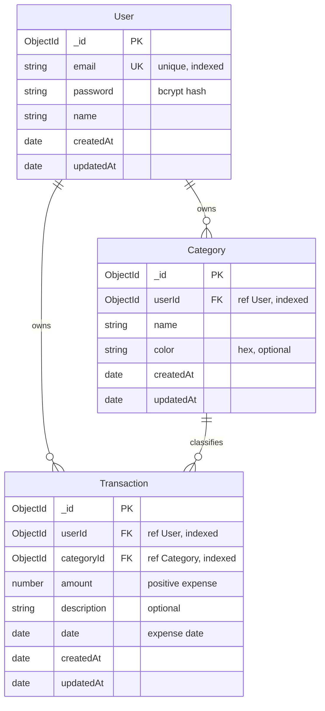

# Budget Tracker — Data Model

This document defines the MongoDB collections, relationships, indexes, and design decisions for the Budget Tracker application. It is the source of truth for schema design before Mongoose models are implemented in Step 4–7.

## Overview

Budget Tracker stores three collections:

| Collection      | Purpose |
|----------------|---------|
| `users`         | Registered accounts (auth identity) |
| `categories`    | Per-user spending labels with optional chart colors |
| `transactions`  | Individual expense records linked to a user and category |

All user-owned data is isolated by `userId`. The Express API enforces this on every read and write — equivalent to BaaS row-level read/write permissions, but implemented in our custom data-access layer.

## Entity Relationship Diagram



### Relationships

- **User → Category (1:N)** — Each category belongs to exactly one user. Users customize their own category names and colors.
- **User → Transaction (1:N)** — Each transaction belongs to exactly one user. Users never see another user's expenses.
- **Category → Transaction (1:N)** — Each transaction references one category. A category can have many transactions; deleting a category may require handling orphaned references (see constraints below).

## Collections

### `users`

Stores authentication identity and display profile. Passwords are hashed with bcrypt before persistence and are never returned in API responses.

| Field        | Type     | Required | Constraints / Notes |
|-------------|----------|----------|---------------------|
| `_id`       | ObjectId | auto     | Primary key |
| `email`     | String   | yes      | Unique, lowercase-trimmed, validated format |
| `password`  | String   | yes      | bcrypt hash only; min length enforced at registration |
| `name`      | String   | yes      | Display name shown in dashboard header |
| `createdAt` | Date     | auto     | Mongoose `timestamps` |
| `updatedAt` | Date     | auto     | Mongoose `timestamps` |

**Indexes**

| Index | Type | Purpose |
|-------|------|---------|
| `{ email: 1 }` | unique | Fast login lookup; prevent duplicate accounts |

---

### `categories`

Per-user spending categories. Default categories (e.g. Food, Transport) may be seeded on registration; users can create, rename, and recolor their own.

| Field        | Type     | Required | Constraints / Notes |
|-------------|----------|----------|---------------------|
| `_id`       | ObjectId | auto     | Primary key |
| `userId`    | ObjectId | yes      | Ref `users._id`; scopes all category queries |
| `name`      | String   | yes      | Trimmed; unique per user |
| `color`     | String   | no       | Hex color (e.g. `#3B82F6`) for chart segments |
| `createdAt` | Date     | auto     | Mongoose `timestamps` |
| `updatedAt` | Date     | auto     | Mongoose `timestamps` |

**Indexes**

| Index | Type | Purpose |
|-------|------|---------|
| `{ userId: 1, name: 1 }` | unique compound | Prevent duplicate category names per user |
| `{ userId: 1 }` | single | List all categories for a user |

**Constraints**

- API must verify `category.userId === req.user.id` before update or delete.
- On category delete: either block if transactions exist, reassign transactions, or cascade-delete — MVP will block delete when transactions reference the category (return 409).

---

### `transactions`

Individual expense records. Amounts represent positive spending values (no income/negative amounts in MVP).

| Field         | Type     | Required | Constraints / Notes |
|--------------|----------|----------|---------------------|
| `_id`        | ObjectId | auto     | Primary key |
| `userId`     | ObjectId | yes      | Ref `users._id`; scopes all transaction queries |
| `categoryId` | ObjectId | yes      | Ref `categories._id`; must belong to same user |
| `amount`     | Number   | yes      | Positive number; stored as decimal (e.g. `12.34`) |
| `description`| String   | no       | Optional memo; max length enforced in validation |
| `date`       | Date     | yes      | When the expense occurred; defaults to today |
| `createdAt`  | Date     | auto     | When the record was created in the system |
| `updatedAt`  | Date     | auto     | Mongoose `timestamps` |

**Indexes**

| Index | Type | Purpose |
|-------|------|---------|
| `{ userId: 1, date: -1 }` | compound | List transactions by user, newest expense date first |
| `{ userId: 1, categoryId: 1 }` | compound | Filter transactions by category; analytics by-category |
| `{ userId: 1 }` | single | Base scope for all user queries |

**Constraints**

- `categoryId` must reference a category where `category.userId === transaction.userId`; reject with 400 if not.
- API must verify `transaction.userId === req.user.id` before read, update, or delete.

---

## Read/Write Scope (Per-User Isolation)

Because we use a custom Express backend (not BaaS), authorization is enforced in application code rather than database rules:

| Operation | Scope rule |
|-----------|------------|
| **Create** category or transaction | Set `userId` from authenticated JWT (`req.user.id`); never accept `userId` from client body |
| **Read** list or single document | Filter/query always includes `{ userId: req.user.id }` |
| **Update** or **delete** | Fetch by `_id` **and** `userId`; return 404 if not found (avoid leaking existence of other users' IDs) |
| **Analytics** aggregations | `$match: { userId: ObjectId(req.user.id) }` as first pipeline stage |

Anonymous requests to protected routes return **401 Unauthorized**. Cross-user access attempts return **404 Not Found** (preferred over 403 to avoid ID enumeration).

---

## Design Decisions

| Decision | Choice | Why (not just what) |
|----------|--------|---------------------|
| **Data store** | MongoDB (NoSQL) | Expense records are document-shaped with flexible optional fields (`description`, `color`). Schema evolution (e.g. adding tags later) does not require migrations. Atlas provides managed hosting with a free tier suitable for coursework. |
| **Backend approach** | Custom Express API + Mongoose | Full control over JWT auth, validation, and aggregation pipelines for charts. A BaaS could work, but a custom backend demonstrates the data-access layer and maps directly to course backend requirements. |
| **User data isolation** | `userId` on `categories` and `transactions` | Multi-tenant pattern: every query filters by the authenticated user. Simpler than embedding transactions inside user documents and avoids unbounded array growth on the user document. |
| **Categories as separate collection** | `categories` collection (not embedded in user) | Users customize names and colors independently. Categories are referenced by many transactions; a separate collection keeps transaction documents small and enables category CRUD without rewriting transaction arrays. |
| **Expense `date` vs `createdAt`** | Dedicated `date` field | Users often log expenses after the fact (e.g. yesterday's lunch). `date` is the business date for charts and filters; `createdAt` is audit metadata for when the row was entered. |
| **Unique category name per user** | Compound index `{ userId, name }` | Prevents duplicate "Food" categories for one user while allowing different users to each have "Food". |
| **Positive amounts only (MVP)** | `amount` > 0 | Scope is expense tracking only. Income and transfers are backlog items; keeping amounts positive simplifies dashboard totals and chart math. |
| **Auth mechanism** | JWT + bcrypt | Stateless API suits a SPA frontend. bcrypt with cost factor ≥ 10 protects passwords at rest. JWT secret lives in `JWT_SECRET` env var, never in code. |
| **Analytics on server** | MongoDB aggregation pipelines | Chart endpoints return pre-aggregated totals (`by-category`, `over-time`). Reduces payload size, keeps business logic in one place, and avoids shipping all transactions to the client for client-side reduction. |
| **404 on cross-user access** | Not 403 | Returning 404 when `_id` exists but `userId` mismatches prevents attackers from confirming valid object IDs belonging to other users. |

---

## Sample Documents

### User

```json
{
  "_id": "665a1b2c3d4e5f6789012345",
  "email": "alex@example.com",
  "password": "$2b$10$...bcrypt-hash...",
  "name": "Alex",
  "createdAt": "2026-06-01T12:00:00.000Z",
  "updatedAt": "2026-06-01T12:00:00.000Z"
}
```

### Category

```json
{
  "_id": "665a1b2c3d4e5f6789012346",
  "userId": "665a1b2c3d4e5f6789012345",
  "name": "Food",
  "color": "#EF4444",
  "createdAt": "2026-06-01T12:05:00.000Z",
  "updatedAt": "2026-06-01T12:05:00.000Z"
}
```

### Transaction

```json
{
  "_id": "665a1b2c3d4e5f6789012347",
  "userId": "665a1b2c3d4e5f6789012345",
  "categoryId": "665a1b2c3d4e5f6789012346",
  "amount": 14.50,
  "description": "Lunch at cafe",
  "date": "2026-06-20T00:00:00.000Z",
  "createdAt": "2026-06-20T18:30:00.000Z",
  "updatedAt": "2026-06-20T18:30:00.000Z"
}
```

---

## Verify Checklist (Step 1)

- [x] ERD shows relationships between User, Category, and Transaction
- [x] Each collection has field types, constraints, and indexes documented
- [x] Design decisions table explains *why*, not just *what*
- [x] Read/write scope documented: all queries filtered by `userId`
