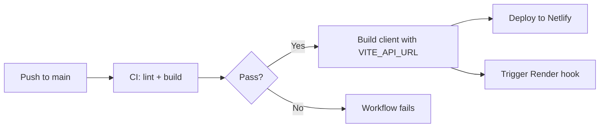

# Budget Tracker — Deployment Guide

This document covers hosting MongoDB Atlas, the Express API on Render, the React client on Netlify, and automatic deployment via GitHub Actions.

## Architecture in production

```
                    ┌──────────────┐
                    │   Netlify    │  React static site (client/dist)
                    │   Frontend   │  VITE_API_URL → Render API
                    └──────┬───────┘
                           │ HTTPS
                           ▼
                    ┌──────────────┐
                    │    Render    │  Express API (server/)
                    │    Backend   │  CLIENT_URL → Netlify origin
                    └──────┬───────┘
                           │ Mongoose
                           ▼
                    ┌──────────────┐
                    │ MongoDB Atlas│  users, categories, transactions
                    └──────────────┘
```

## 1. MongoDB Atlas

1. Create a free cluster at [mongodb.com/atlas](https://www.mongodb.com/atlas).
2. Create a database user with read/write access.
3. Add your IP (or `0.0.0.0/0` for development) under **Network Access**.
4. Copy the connection string and replace `<password>` and database name.

Use this value for `MONGODB_URI` on Render (never commit it to git).

## 2. Backend — Render

The repo includes `render.yaml` as a blueprint for the API service.

### Manual setup

1. Create a **Web Service** on [render.com](https://render.com) connected to this GitHub repo.
2. Set **Root Directory** to `server`.
3. **Build command:** `npm install`
4. **Start command:** `npm start`
5. **Health check path:** `/api/health`

### Environment variables (Render dashboard)

| Variable | Example | Notes |
|----------|---------|-------|
| `MONGODB_URI` | `mongodb+srv://...` | From Atlas |
| `JWT_SECRET` | long random string | Same security rules as local |
| `JWT_EXPIRES_IN` | `7d` | Optional |
| `CLIENT_URL` | `https://budgetcash.netlify.app` | Netlify site URL for CORS |
| `NODE_ENV` | `production` | Enables secure cookies |
| `GEMINI_API_KEY` | (from Google AI Studio) | **Server only** — required for AI features |
| `AI_MODEL` | `gemini-2.5-flash` | Gemini model for category suggestion and insights |
| `AI_RATE_LIMIT_WINDOW_MS` | `3600000` | Optional; per-user AI rate-limit window |
| `AI_RATE_LIMIT_MAX` | `30` | Optional; max AI requests per user per window |
| `PORT` | `10000` | Render sets this automatically |

After deploy, the API URL is `https://budget-tracker-api-70sh.onrender.com`.

Verify:

```bash
curl https://budget-tracker-api-70sh.onrender.com/api/health
# {"status":"ok"}
```

### Deploy hook (optional)

In Render → Service → **Deploy Hook**, copy the hook URL. Add it as GitHub secret `RENDER_DEPLOY_HOOK_URL` so pushes to `main` can trigger a backend redeploy.

## 3. Frontend — Netlify

The repo includes `netlify.toml`:

```toml
[build]
  base = "client"
  command = "npm run build"
  publish = "dist"

[[redirects]]
  from = "/*"
  to = "/index.html"
  status = 200
```

The SPA redirect ensures React Router paths work on refresh.

### Option A: GitHub Actions deploy (recommended)

The workflow in `.github/workflows/ci.yml` deploys to Netlify on every push to `main` after CI passes. Configure these **GitHub repository secrets**:

| Secret | Where to get it |
|--------|-----------------|
| `VITE_API_URL` | `https://budget-tracker-api-70sh.onrender.com/api` |
| `NETLIFY_AUTH_TOKEN` | Netlify → User settings → Applications → Personal access tokens |
| `NETLIFY_SITE_ID` | Netlify → Site settings → Site information |
| `RENDER_DEPLOY_HOOK_URL` | Render deploy hook (optional) |

### Option B: Netlify UI only

1. Connect the repo in Netlify.
2. Build settings are read from `netlify.toml`.
3. Set **Environment variable** `VITE_API_URL` to your production API URL.

## 4. CI/CD pipeline flow

**Trigger:** push or pull request to `main`

### Job: `ci` (Lint and build)

1. Checkout code
2. Setup Node.js 20 with npm cache
3. `npm ci` in `server/` and `client/`
4. `npm run lint` in `client/`
5. `npm run build` in `client/` (uses `VITE_API_URL` secret or localhost fallback)

### Job: `deploy` (production only)

Runs when `ci` succeeds on a **push to `main`**:

1. Build client with production `VITE_API_URL`
2. Deploy `client/dist` to Netlify (`nwtgck/actions-netlify`)
3. POST to `RENDER_DEPLOY_HOOK_URL` if configured



## 5. CORS configuration

The API reads `CLIENT_URL` and passes it to the `cors` middleware:

```javascript
cors({
  origin: CLIENT_URL || true,
  credentials: true,
})
```

**Production checklist:**

- `CLIENT_URL` on Render = exact Netlify URL (no trailing slash mismatch)
- `VITE_API_URL` on Netlify/GitHub = Render API base + `/api`

## 6. Post-deploy verification

1. Open the Netlify URL in a browser.
2. Register a test account.
3. Create a category and add an expense.
4. Confirm charts and summary update.
5. Log out and confirm `/dashboard` redirects to login.

Update the live demo link in [README.md](../README.md):

```markdown
**Live demo:** https://budgetcash.netlify.app
```

Verify the API separately (for deploy troubleshooting, not end users):

```bash
curl https://budget-tracker-api-70sh.onrender.com/api/health
# {"status":"ok"}
```

## 7. Secrets hygiene

| Do | Don't |
|----|-------|
| Store secrets in Render/Netlify/GitHub Secrets | Commit `.env` files |
| Use `.env.example` with placeholders | Put real `MONGODB_URI` or `JWT_SECRET` in git |
| Rotate `JWT_SECRET` if exposed | Share tokens in issues or chat |

`.gitignore` excludes `.env`, `node_modules/`, `dist/`, and `.netlify/`.

## 8. Local vs production summary

| Setting | Local | Production |
|---------|-------|------------|
| Client URL | `http://localhost:5173` | `https://*.netlify.app` |
| API URL | `http://localhost:5001/api` | `https://*.onrender.com/api` |
| `CLIENT_URL` | `http://localhost:5173` | Netlify URL |
| `NODE_ENV` | `development` | `production` |
| MongoDB | Atlas (same cluster OK) | Atlas |

## Related documentation

- [README.md](../README.md) — quick start and env tables
- [ARCHITECTURE.md](./ARCHITECTURE.md) — system design
- [../.github/workflows/ci.yml](../.github/workflows/ci.yml) — workflow source
